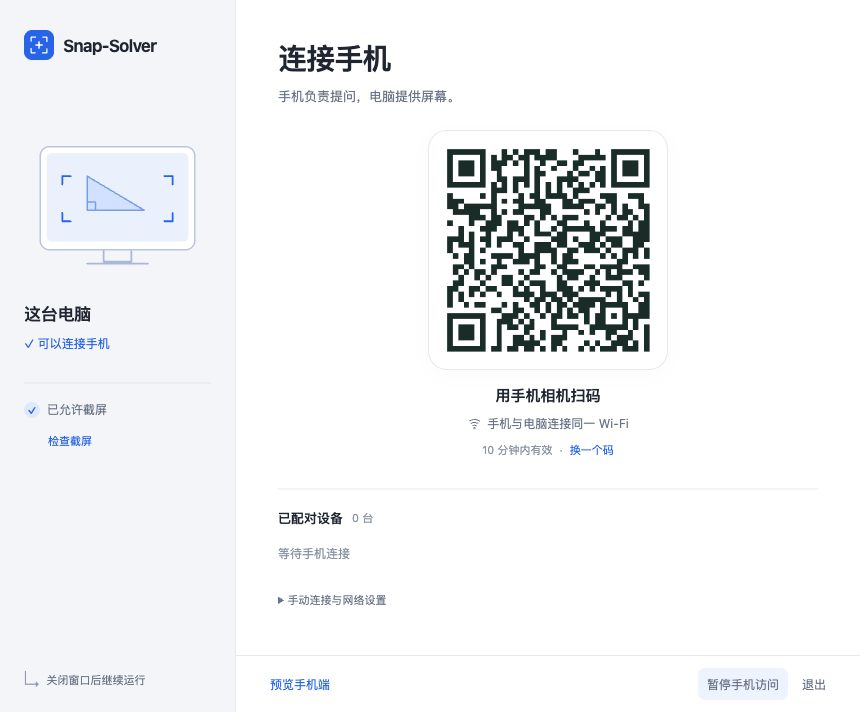

# Snap-Solver

电脑负责截屏，手机负责对话。

在 macOS / Windows 启动桌面 App，手机连同一局域网并扫码。每次截屏添加一张图片，可以连续添加、按需框选，再把图片与问题一起发送。



[手机多图输入界面](artifacts/phone.png) · [模型设置界面](artifacts/models.png)

## 源码启动

需要 Node.js 22+，以及 [uv](https://docs.astral.sh/uv/getting-started/installation/) 或 Python 3.12。

```sh
npm ci
npm run setup
npm start
```

`setup` 优先使用 uv 创建 `.runtime` 并准备 Python 3.12；没有 uv 时，macOS 使用 `python3.12`、Windows 使用 `py -3.12`。首次安装需要联网下载 Electron、Python 运行环境与聊天框架。后续使用不需要 Docker。

这是源码开发版本，暂未生成安装包、签名或公证。

## 使用

1. 在电脑打开 App，允许屏幕录制权限；macOS 开发态权限名称是 **Electron**，授权后重启。
2. 手机连接同一 Wi-Fi，扫描二维码。
3. 点击页面右上角的 **连接模型**，添加 API Key；之后可通过 **模型设置** 管理连接。也会首次导入旧版 `.snapsolver/` 中的现有密钥和提示词。
4. 点击 **截屏** 直接追加整屏图片；旁边的 **框选** 用于裁剪。可以连续添加多张（每次最多 12 张）；图片按顺序编号，点开可翻看与放大，删除和清空可在 10 秒内撤销。
5. 写下问题，统一发送。回答后可继续追问或切换模型。

电脑关窗后继续在菜单栏 / 托盘运行；退出 App 会停止后台服务。二维码与连接码 10 分钟轮换，已配对设备不会因此掉线。通常重启会复用原端口；端口被占用或电脑更换网络时，请重新扫码。

手机之间共享这台电脑的聊天记录和模型设置，适合个人设备。桌面可以撤销设备或暂停访问。局域网连接使用 HTTP，只在可信局域网使用，不应直接映射到公网。

## 聊天运行层与模型

复用 **[Open WebUI 0.12.2](https://github.com/open-webui/open-webui/releases/tag/v0.12.2)** 的现有 UI 和运行层：多轮对话、历史、流式输出、停止、模型切换、Markdown / 公式 / 代码。截图作为它原生的图片附件加入，没有再实现一套聊天引擎。

2026-10-16 按官方目录整理了 6 家服务、16 款支持图像输入的模型：OpenAI、Anthropic、Google、通义千问、豆包、Kimi。型号、协议及来源见 [模型目录](config/providers.json) 和 [架构说明](docs/architecture.md)。手机端只保留模型连接表单，可修改内置服务的兼容地址。是否可调用取决于账户、地区、服务地址和模型权限。

手机界面保留截图、图片附件、聊天、历史和模型切换。语音通话、工作空间、知识库、联网搜索、图像生成、工具与管理面板等不再作为产品入口；相关写入路由在网关禁用。启动时按产品边界覆盖旧的功能开关，保留模型密钥与聊天记录。自动标题、自动追问等额外模型请求保持关闭。

## 数据与迁移

- 密钥、聊天、附件保存在 Electron 的应用数据目录。macOS 通常为 `~/Library/Application Support/Snap-Solver/`，Windows 为 `%APPDATA%/Snap-Solver/`。
- 截屏只发生在主动点击时；发送后，所选图片、文字及对话上下文会交给所选模型服务。
- 旧 `.snapsolver/` 和 `config/prompts.json` 只读迁移，不删除原文件。原提示词成为 `/snap-…` 快捷提示词，可在原生聊天框里输入 `/` 使用。
- 新框架已有设置优先，重启不会覆盖在手机上做的修改；导入后可移除某家密钥而不被再次导回。
- 旧版浏览器里的临时结果没有统一的会话存储，本次没有将它们转换成新聊天记录。

详细步骤见 [使用指南](docs/beginner-tutorial.md)。

## 开发与验证

```sh
npm run check
npm test
npx playwright install chromium webkit
npm run test:ui
npm run test:desktop
```

浏览器测试使用真实 Open WebUI 和本地模拟模型，**不使用真实 API Key、不调用外部模型**。桌面检查使用独立数据目录，实际调用本机截屏。验证范围和限制见 [验收记录](docs/verification.md)。

| 目录          | 职责                                          |
| ------------- | --------------------------------------------- |
| `desktop/`    | Electron 生命周期、系统截屏、局域网配对与代理 |
| `desktop/ui/` | 桌面连接窗口                                  |
| `web/`        | 手机配对、模型初设、截图附件与框选扩展        |
| `runtime/`    | 固定版本的 Open WebUI 启动入口与依赖          |
| `config/`     | 模型目录与提示词种子                          |
| `tests/`      | 配对测试、真实框架浏览器流程及模拟模型        |

本项目遵循仓库的 [MIT License](LICENSE)。Open WebUI 是单独安装的第三方组件，保留其界面标识与许可要求；见 [第三方说明](THIRD_PARTY_NOTICES.md)。
