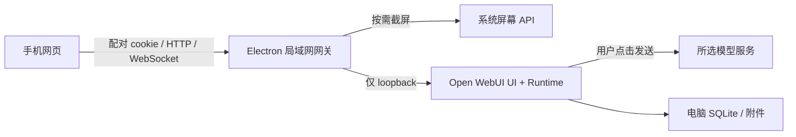

# 运行架构

## 组件分工

选择 Electron，是因为跨 macOS / Windows 的屏幕获取、权限状态、托盘与 Node 服务可以共用一个进程入口。Open WebUI 自带多模型聊天 UI 和运行层，使用官方 slim 依赖与原版 wheel，不运行 Docker，不再维护另一套消息协议或模型 SDK。

桌面 Chromium renderer 只加载本地连接页面，启用 sandbox / contextIsolation，禁用 Node integration。窄 IPC 只接受本地窗口，不能用手机页面调用任意系统命令。模型请求由 Python 运行层发出。

## 请求边界

- 公网模型连接仅由 Open WebUI 持有；服务端只监听 `127.0.0.1` 的动态端口。
- 对外网关监听局域网，验证 Host、Origin、设备 cookie；WebSocket 使用同样的边界。
- 二维码携带高熵短期凭证，放在 URL fragment 中；配对后移除 fragment，只保存 HttpOnly / SameSite=Strict cookie。
- 服务器只持久化设备 token 的哈希；配对尝试限速，最多 8 台设备。
- 撤销设备会销毁对应连接，后续请求必须重新配对。暂停访问会断开手机通道，**不等于停止后台模型生成**。
- 正常退出终止运行层；父进程异常消失时，Python watchdog 也会退出，避免留下孤儿服务。
- 网关优先复用持久化端口；冲突时重新分配。局域网地址变化后重新扫码，后端 Origin 始终是 loopback。

HTTP 局域网链路没有传输加密，不提供公网反向代理部署方案。配对手机拥有同一个本地用户的聊天与管理权限，不是多租户系统。

## 截图附件

原生截图最长边限制为 2560 像素。默认点击一次，向当前输入框追加一个 JPEG；文字草稿与既有附件不变。框选入口按需加载本地 Cropper.js，并复用上一次同屏幕、同尺寸的选区。

通过 Open WebUI 原有编辑器的图片粘贴接口加入附件，等待缩略图出现才确认加入。发送、历史、重试、停止、Markdown 和模型选择均由上游处理。未找到编辑器、已切换聊天或当前模型不接受图片时，扩展显示可见错误。

`web/composer.js` 封装固定版本的编辑器和原生附件 DOM 接口。`attachments.js` 为同一列表增加编号、预览与删除恢复，不维护第二份待发送列表。撤销时只短暂保留 Blob（10 秒），通过同一个粘贴入口追加到末尾；清空从末项开始操作，避免上游非 keyed 列表的索引变化。截图与图片处理期间拦截点击发送和 Enter；异步操作绑定编辑器、路由和对话代次，切换对话后拒绝插入。

`web/layout.js` 只标记固定版本的原生布局节点、添加空稿引导，并根据 VisualViewport 调整可用高度。新草稿用图片网格，聊天与短视口用横条；图片始终是同一份原生附件 DOM。`web/tokens.css` 是手机、配对 / 模型页和桌面窗口共享的颜色与字体源。上游品牌仍保留，新增布局适配需随上游版本升级重新验证。

界面附件上限与运行层共用 `config/product-scope.json` 的 12 张限制。`scope.js` 和样式收起非核心入口，网关阻断非核心页面和写入路由。启动时通过上游配置接口覆盖产品管理的功能开关，不覆盖模型连接、密钥、用户偏好或历史。这是产品裁剪，不改变配对手机共用本机账户的边界。

扩展固定依赖 `#chat-input` / `#message-input-container`、图片粘贴、附件和菜单 DOM 接口。框架升级时必须重新跑实际 Chromium / WebKit 测试；不要在扩展里复制聊天状态。

## 模型目录与协议

内置模型以 `厂商.型号` 作为内部 ID，展示名称由原生模型配置提供。协议由 Open WebUI 统一处理：

| 服务      | 型号系列                                             | 接口                               |
| --------- | ---------------------------------------------------- | ---------------------------------- |
| OpenAI    | GPT-6.1 Sol / GPT-6 Astra / GPT-6 Luna               | Responses                          |
| Anthropic | Claude Sonnet 5.5 / Opus 5.5 / Fable 5.1 / Haiku 5.5 | OpenAI compatible Chat Completions |
| Google    | Gemini 3.8 Flash / 3.5 Flash Lite                    | OpenAI compatibility endpoint      |
| 阿里      | Qwen 3.8 Max / 3.8 Flash / 3.7 Plus                  | DashScope compatible endpoint      |
| 字节      | Doubao Seed 2.1 Pro / Lite / Turbo                   | Ark v3                             |
| Moonshot  | Kimi K3                                              | Chat Completions                   |

这是截图对话集成，没有承诺每家原生 API 的全部思考、工具、实时音视频能力。模型有图像输入能力也不代表特定账户有访问权限。

核验日期为 2026-10-16，来源：[OpenAI](https://developers.openai.com/api/docs/models)、[Anthropic](https://platform.claude.com/docs/en/models/overview)、[Google](https://ai.google.dev/gemini-api/docs/models)、[阿里云](https://help.aliyun.com/zh/model-studio/vision-model/)、[火山方舟](https://docs.volcengine.com/docs/ark/model-list)、[Kimi](https://www.kimi.com/help/kimi-api/api-overview)。精确 ID 以 `config/providers.json` 为准。

首次初始化导入内置模型显示配置与旧提示词，写入迁移标记。已有自定义设置不覆盖。模型连接修改串行执行，避免多手机同时保存导致配置丢失。

## 依赖与开发配置

- Electron 44.8.0 / Open WebUI 0.12.2 / Cropper.js 1.6.2。
- `runtime/requirements-slim.txt` 保留上游来源；`requirements.lock` 锁定跨平台传递依赖。
- `SNAP_DATA_DIR`：隔离数据目录，测试使用。
- `SNAP_LEGACY_DIR`：只读的旧配置目录，默认 `.snapsolver`。
- `SNAP_PYTHON`：已装好固定版本运行层的 Python 路径。
- `SNAP_PORT`：指定网关端口；显式端口被占用时显示启动错误。
- API Key 可通过目录里的 `envKey` 对应环境变量提供，首次连接配置会读取它；之后以保存到本机的设置为准。

不使用前端 CDN、外部字体、远程裁剪库或在线二维码服务。新 App 运行时不再依赖旧 `app.py`、`models/`、模板或手写 Socket.IO 聊天流程。
